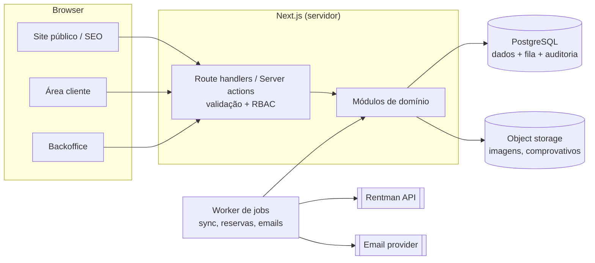
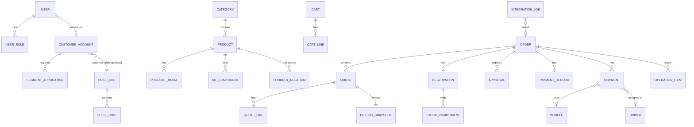
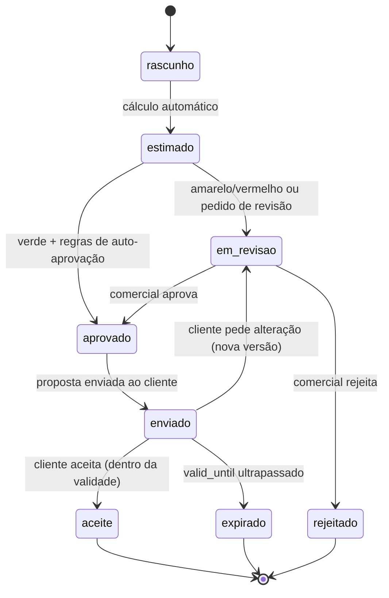
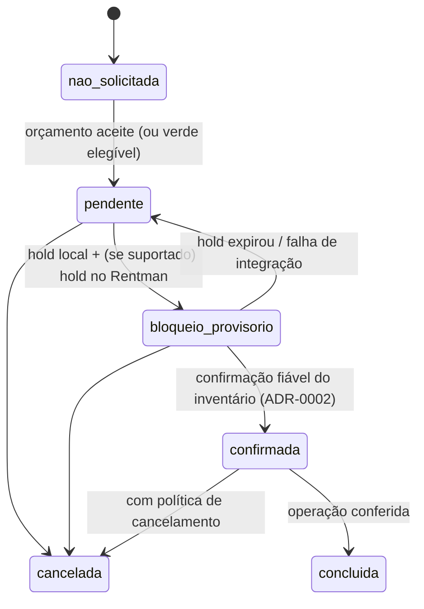

# Arquitetura — proposta v0.1 (AGUARDA APROVAÇÃO)

> Estado: **proposta**. Não há código de produção até o proprietário aprovar este documento (gate da Etapa 0).
> As versões de bibliotecas são verificadas no momento da instalação (Etapa 2), não aqui.

## 1. Visão geral

Um **monólito modular** em TypeScript: uma aplicação Next.js (site público, área de cliente e backoffice) e um **processo worker** separado para jobs. Ambos partilham o mesmo código de domínio e a mesma base PostgreSQL.



Regras de fronteira:
- O browser **nunca** fala com o Rentman nem com prestadores externos.
- Pedidos HTTP do utilizador **não** chamam o Rentman de forma síncrona, exceto na verificação de disponibilidade com timeout curto e fallback (ver §6). Escritas no Rentman passam sempre pela fila.
- Cada adaptador externo implementa uma interface do domínio (port) e tem uma implementação `Fake` para testes e dev. O `Fake` regista-se como tal nos logs e no painel de admin, para nunca ser confundido com produção.

## 2. Módulos

Os módulos seguem a Bíblia §11. Cada um vive em `src/modules/<nome>/` com `domain/` (puro, sem I/O), `application/` (casos de uso), `infra/` (repositórios, adaptadores) e `index.ts` (API pública).

| Módulo | Responsabilidade | Depende de |
|---|---|---|
| `identity-access` | Utilizadores, sessões, papéis, permissões (RBAC) | audit |
| `customers` | Contas de cliente, empresas, segmento, aprovação B2B, moradas, consentimentos | identity-access, audit |
| `catalog` | Produtos, categorias, especificações, media, ligação ao ID Rentman, kits (composição) | — |
| `kit-rules` | Relações obrigatório/opcional/incompatível/substituto/condicional, versionadas | catalog |
| `pricing` | Tabelas de preço por segmento, duração, mínimos, descontos, transporte, serviços, IVA. Motor puro de cálculo | catalog, customers |
| `availability` | Ledger interno de compromissos de stock + leitura de disponibilidade (via rentman-adapter) | catalog, rentman-adapter |
| `capacity` (semáforo) | Calendário operacional, feriados, SLA, overrides, avaliação da cor | — |
| `quotes` | Carrinho → orçamento, linhas, snapshot imutável, versões, estados | pricing, kit-rules, capacity, availability |
| `approvals` | Filas de revisão comercial/técnica, decisões, motivos | quotes, identity-access |
| `reservations` | Reserva e estados, holds, confirmação segura, cancelamento | availability, rentman-adapter |
| `rentman-adapter` | Cliente HTTP, mapeamento, rate limiting, idempotência, sync, reconciliação | — (só infra) |
| `warehouse` | Picking, checklist, saída, retorno, incidências, estado por item/case | reservations, catalog |
| `logistics` | Entregas/recolhas, veículos, motoristas, janelas, comprovativos | reservations |
| `payments` | Registo manual, comprovativos, estados; port para prestadores futuros | quotes |
| `content-seo` | Páginas, landing pages, portfólio, FAQ, metadados, sitemap, structured data | catalog |
| `notifications` | Templates, envio via port (email agora), outbox | — |
| `audit` | Registo append-only de ações e transições | — |
| `reporting` | Métricas e dashboards (leitura) | todos (só leitura) |

A comunicação entre módulos faz-se por chamadas à API pública ou por **eventos de domínio** gravados numa tabela outbox na mesma transação. O worker consome-os. Isto evita perder notificações e jobs quando há falhas.

## 3. Stack proposta (justificação curta; versões a confirmar na Etapa 2)

| Área | Escolha proposta | Porquê / alternativa |
|---|---|---|
| Linguagem | TypeScript (strict) | Pedido pela Bíblia; tipagem fim a fim |
| Web | Next.js (App Router) | SSR/SSG para SEO, um único deploy para público e backoffice |
| BD | PostgreSQL | Transações, locks, `tstzrange`, JSONB para snapshots |
| ORM/migrations | Drizzle ORM + drizzle-kit | Próximo do SQL, o que facilita locks e constraints. Alternativa: Prisma |
| Validação | Zod | Schemas partilhados entre servidor, formulários e contratos de adaptadores |
| Fila/jobs | pg-boss (fila em PostgreSQL) | Sem Redis no MVP; jobs transacionais com o outbox. Alternativa: BullMQ + Redis |
| Auth | Biblioteca mantida com sessões em BD (candidatas: Better Auth, Auth.js). Decisão na Etapa 2 (ADR) | Sessões revogáveis, sem JWT de longa duração |
| Testes | Vitest (unit/integração), Testcontainers/Postgres efémero, Playwright (E2E) | Playwright já existe em CI comum |
| Observabilidade | Logs estruturados (pino), OpenTelemetry, Sentry ou equivalente | Erros, traces das integrações, alarmes |
| Storage | S3-compatível na UE | Imagens, comprovativos, documentos |
| Email | Port `EmailSender`; prestador transacional na UE a escolher | Trocável |

**Hospedagem:** região UE (RGPD). O worker de longa duração favorece uma **plataforma de containers** (app + worker + Postgres gerido + backups) em vez de serverless puro. Opções a comparar (custo, limites, backups, região UE) na tarefa TASK-004: PaaS de containers na UE; Vercel (web) com worker e Postgres separados; VPS gerida. **Não indico custos aqui:** serão recolhidos das páginas oficiais na data da decisão e apresentados para aprovação.

## 4. Modelo de dados inicial (conceptual)

Convenções: `id uuid`, `created_at/updated_at timestamptz`, dinheiro em `*_cents bigint` (EUR), períodos em `tstzrange`, soft-delete apenas onde a retenção o exija.



Entidades principais e campos-chave:
- **user**, **user_role** (`role` ∈ visitor implícito, customer, sales, warehouse, operations, driver, admin), **session**.
- **customer_account**: tipo (`individual|company`), NIF (opcional B2C, obrigatório B2B), `segment` (`b2c|agency|rental_company`), `segment_status` (`none|pending|approved|rejected|revoked`), `price_list_id` (só com segmento aprovado).
- **segment_application**: documentos, revisor, decisão, motivo e data. A auditoria é obrigatória.
- **product**: `sku`, `rentman_id` (nullable até ao mapeamento), `slug` estável, nome, categoria, descrição, specs (JSONB validado), dimensões/peso, `public_reference_price_cents`, `rental_policy`, flags `requires_review`, `is_service`, `is_public`.
- **kit_component**: kit → produto, quantidade, `fixed|configurable`.
- **product_relation** (kit-rules): `source_product_id`, `target_product_id | target_category_id`, `type` (`required|optional|incompatible|substitute|conditional`), `condition` (JSONB, DSL determinística validada), `reason_text`, `ruleset_version`, `approved_by`, `approved_at`.
- **price_list** / **price_rule**: segmento, produto/categoria, unidade (dia/fim-de-semana/…, **a decidir**), escalões de duração e de quantidade, mínimos, `valid_from/to`, versão.
- **tax_rate**: taxa por região/tipo e vigência (configurável; não hard-coded).
- **cart** / **cart_line**: período, local, modalidade (`pickup|delivery`), quantidades, sugestões aceites com a regra de origem.
- **order** (pedido): agregador com `public_ref`, cliente, período, local, `traffic_light` avaliado + motivos, estados independentes (abaixo) e `idempotency_key` de submissão.
- **quote** / **quote_line**: versionado por pedido; linhas por tipo (`equipment|service|logistics|discount|tax`), `valid_until`.
- **pricing_snapshot**: JSONB imutável (regras, taxas, preços, versões de ruleset). Escrita única, sem `UPDATE`, com trigger que o impede.
- **reservation** + **stock_commitment**: produto, quantidade, `period tstzrange` (com margens de preparação/transporte), `kind` (`provisional_hold|confirmed|out|returned`), `expires_at` para holds, `rentman_ref`.
- **approval**: tipo (`commercial|technical|operational|segment`), decisor, decisão, motivo.
- **payment_record**: valor, método declarado, data, comprovativo (storage key), registado por, estado.
- **shipment**: tipo (`delivery|collection`), janela, morada, veículo, motorista, estado, comprovativo (foto/assinatura/nome).
- **operation_item**: item/case/nº de série (quando existir), localização operacional (`warehouse|in_transit|at_event|maintenance|returning`), origem do dado e timestamp.
- **capacity_calendar**, **holiday**, **capacity_override** (quem, quando, porquê, até quando), **sla_policy**.
- **integration_job** / **integration_dead_letter**, **sync_cursor**, **reconciliation_report**.
- **audit_log**: append-only (`actor`, `action`, `entity`, `before/after` minimizados, `ip`, `at`).
- **outbox_event**: eventos de domínio para o worker.
- **content_page**, **portfolio_case** (+ `consent_record` para imagens e testemunhos), **lead**.

## 5. Mapas de estado

Os quatro objetos têm máquinas **independentes** (Bíblia §4). Cada transição é uma função de domínio pura que valida a pré-condição e emite o evento. O registo em `audit_log` é obrigatório.

### Orçamento

Alterar um orçamento enviado cria uma **nova versão**; as versões antigas e os seus snapshots mantêm-se intactos.

### Reserva


### Operação
`a_preparar → pronto → expedido → entregue → em_utilizacao → recolha → devolvido → conferido`, com o ramo `incidencia` (dano, falta) a partir de `devolvido`. Para levantamento em armazém, `expedido` significa "levantado pelo cliente". **Pré-condição:** `a_preparar` só existe com reserva `confirmada`.

### Pagamento
`nao_registado → pendente → parcial → pago`; `pago → reembolsado`; qualquer estado → `em_disputa`. É independente da reserva. A política de bloquear a expedição sem pagamento é uma regra de negócio **a decidir**.

## 6. Disponibilidade e prevenção de overbooking (resumo da ADR-0002)

1. **Ledger local** (`stock_commitment`) com todos os compromissos feitos pela plataforma, mais a disponibilidade lida do Rentman (cache com TTL curto e timestamp visível).
2. Na tentativa de hold: transação com `pg_advisory_xact_lock(product)` sobre cada produto, ordenados por id para evitar deadlocks. Depois soma os compromissos que se sobrepõem ao período (com margens) e compara com a quantidade disponível conhecida. Se couber, insere o `provisional_hold` com `expires_at`.
3. A confirmação só acontece depois de o Rentman (se a PoC o comprovar) aceitar a reserva/projeto **e** uma releitura confirmar o compromisso. Caso contrário fica `pendente` para aprovação operacional humana.
4. Chamadas de escrita ao Rentman usam `idempotency_key` local e, antes de qualquer retry, uma verificação "já existe?" (ex.: procurar por referência externa, **se a API o permitir**, a verificar). Nunca há retry cego de criação.
5. Reconciliação periódica: compara o ledger local com o Rentman, gera um relatório de divergências e alerta. Nunca corrige automaticamente reservas confirmadas.
6. **Modo degradado:** se o Rentman estiver indisponível, a plataforma aceita pedidos como pendentes, o semáforo passa no máximo a amarelo e a equipa opera manualmente.

Limitação conhecida: reservas feitas diretamente no Rentman por funcionários não passam pelo lock local. Por isso a releitura e a reconciliação são obrigatórias, e a auto-confirmação depende do resultado go/no-go da PoC.

## 7. Motor de preços (puro, determinístico)

`price(cart, customerContext, priceListVersion, taxTable, at) → QuoteDraft`. Sem I/O: recebe tudo como argumentos e é exaustivamente testável.
Ordem proposta (**a validar com o proprietário**): preço base por unidade de tempo → escalão de duração → escalão de quantidade → mínimos → descontos autorizados (com teto por papel) → serviços → logística → IVA por linha → arredondamento.
Cada linha guarda a explicação ("porquê este preço"), que o comercial vê e o cliente vê de forma resumida.

## 8. Motor do semáforo (puro)

`evaluate(order, capacityState, stockStatus, now) → { color, reasons[], slaDeadline? }`
- Vermelho se: fora da janela operacional (calendário + feriados), override "suspenso" ativo ou armazém indisponível.
- Amarelo se: há serviços/montagem/técnicos, itens `requires_review`, stock não verificado ou insuficiente, limites por pedido excedidos (valor, quantidade, distância) ou condições especiais.
- Verde se: nenhuma das anteriores **e** stock verificado há menos de N minutos **e** a auto-confirmação está ligada (feature flag dependente da PoC).
- Vermelho tem precedência sobre amarelo (o prazo de resposta passa a ser o SLA vermelho). Os motivos são sempre devolvidos e mostrados.

## 9. Segurança e RGPD
- RBAC no servidor em cada handler (deny by default), testado por matriz papel × ação.
- Separação entre preços públicos e B2B nos endpoints: as páginas públicas usam apenas `public_reference_price_cents`.
- Sessões em BD, cookies `HttpOnly; Secure; SameSite=Lax`, proteção CSRF nas mutações, rate limiting em login/registo/submissão, validação Zod em todas as entradas e queries parametrizadas pelo ORM.
- PII mínima e segregada por papel (o motorista vê só as entregas atribuídas). Política de retenção, exportação e eliminação de dados de titulares, e consentimentos de marketing e de imagens.
- Segredos em variáveis de ambiente ou num secret manager do host; `.env.example` sem valores.
- Revisão de segurança independente antes da abertura pública.

## 10. Observabilidade
Logs estruturados com `request_id` e `order_id`, métricas de jobs (sucesso, falha, latência, dead-letter), alarmes para falhas de sync, divergências de reconciliação e SLAs vermelhos a expirar, e um painel de saúde da integração no backoffice.

## 11. Estrutura de repositório proposta
```
AGENTS.md  README.md  .env.example
docs/ (este conjunto)
tasks/
src/app/(public)|(account)|(admin)     # rotas Next.js
src/modules/<módulo>/{domain,application,infra,index.ts}
src/worker/                            # entrypoint do worker
src/shared/                            # money, dates (Europe/Lisbon), result, errors
db/migrations/
tests/{unit,integration,e2e,concurrency}
.github/workflows/ci.yml
```
