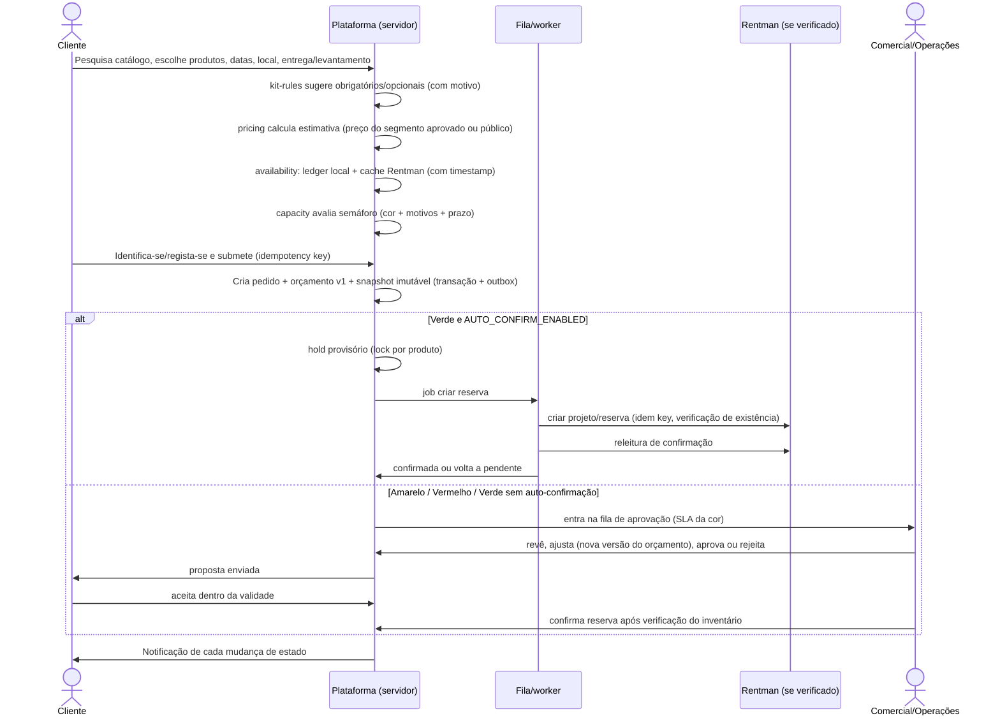

# Fluxo 01: Do catálogo ao pedido (cliente)

Pontos de controlo:
- Um B2B não aprovado vê o preço público e recebe a indicação de que a validação do perfil está pendente.
- A submissão é idempotente: um duplo clique ou um retry de rede não cria dois pedidos.
- Se a disponibilidade não puder ser verificada, o pedido fica amarelo com o motivo "stock não verificado".
